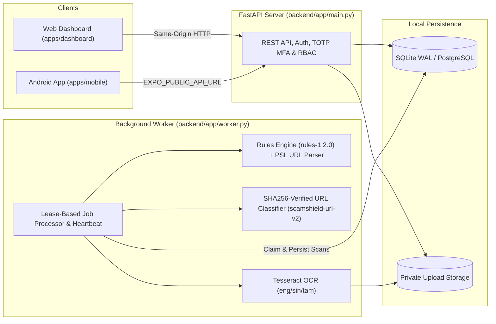

# ScamShield AI

**Explainable Multi-Modal Scam, Phishing URL & Screenshot Detection Platform**

ScamShield AI is a local-first, privacy-preserving cyber defense platform for detecting suspicious URLs, multilingual scam messages (English, Sinhala, Singlish, and Tamil), and messaging screenshots. It combines a deterministic, span-level explainable rules engine (`rules-1.2.0`), an offline Public Suffix List (PSL) URL structural analyzer, an SHA256-verified static URL machine learning classifier (`scamshield-url-v2`), a human-confirmed Tesseract OCR workflow, a responsive web dashboard, and an Expo / React Native Android client.

---

## Key Features

- **Offline Structural URL Inspection & Static ML (`scamshield-url-v2`):** Extracts registrable domain boundaries via the Public Suffix List (PSL), flags brand impersonation (`brand_host`), punycode/IDN homographs, `@` userinfo obfuscation, raw IP literals, non-standard ports, and deep subdomain chains—augmented by a **28-feature `url-static-2` classifier** isolating host/subdomain signals from path tokens without network lookups.
- **Multilingual Scam Text Detection (`rules-1.2.0`):** Detects credential harvesting (OTP/PIN/password requests), urgency pressure, financial/bank suspension traps, fake parcel delivery fees, and lottery lures across **English, Sinhala, Singlish, and Tamil**, while suppressing false positives on legitimate operational warnings (e.g., *"Never share your OTP with anyone"*).
- **Human-in-the-Loop Screenshot OCR:** Validates uploaded images (`PNG`, `JPEG`, `WEBP`), extracts text asynchronously via bundled portable Tesseract 5.5.3 (`eng+sin+tam+osd`), pauses at `awaiting_confirmation` for user review/correction, and runs full scam detection on the confirmed text.
- **Explainable Risk Assessments:** Reports exact character spans, indicator weights, non-clickable URL structural breakdowns, and model provenance (`rules-only` vs. `rules-plus-model`). Scores (`0–100`) are deterministic indicator sums (`0–24` `Inconclusive`, `25–59` `Medium`, `60–100` `High`), never uncalibrated probabilities.
- **Analyst Review Queue & Campaign Clustering:** Users can escalate scans to security analysts, whose verdicts (`Confirmed scam` / `False positive`) propagate directly back into the user's scan history. Staff can inspect clustered scam campaigns grouped by shared domains, phone numbers, and text fingerprints.
- **Role-Based Access Control, TOTP MFA & Audit Logging:** Supports `user`, `analyst`, and `admin` roles. Staff roles require enrolled TOTP multi-factor authentication (with 8 single-use hashed recovery codes), and all privileged actions are recorded in an immutable audit log.

---

## Architecture



---

## Technology Stack

| Layer | Technologies |
|---|---|
| **Backend API & Worker** | Python 3.13, FastAPI, Uvicorn, SQLAlchemy 2.0, Alembic, Pydantic |
| **Database & Queue** | SQLite (WAL mode) by default; PostgreSQL 16 supported; lease-based DB worker queue with heartbeats |
| **AI / ML & Detection** | Deterministic multilingual regex/span rules (`rules-1.2.0`), Public Suffix List (`psl_data.py`), scikit-learn / NumPy static URL logistic classifier (`scamshield-url-v2`, `url-static-2` 28 features), Pillow + Tesseract 5.5.3 OCR (`eng`, `sin`, `tam`, `osd`) |
| **Web Dashboard** | Vanilla JavaScript (`ES2022`), semantic HTML5, responsive CSS (`390px`–`1440px`), zero external runtime dependencies |
| **Android Mobile App** | React Native `0.83.6`, Expo SDK `55`, TypeScript `5.9`, `expo-secure-store`, `expo-image-picker` |
| **Testing & Verification** | Pytest (**103 passed, 1 skipped**), Playwright Headless Chrome E2E (**13 workflow groups across 3 viewports**), live 10-workflow E2E runner (**10/10 passed**), Real OCR test (**9/9 passed fixtures**) |

---

## AI / ML Detection Architecture & Quality Gates

ScamShield AI enforces a strict **95.0% validation precision gate** before any machine learning artifact can be enabled in the background worker:

1. **Active Released URL Model (`scamshield-url-v2` — `ml/artifacts/v2-json/url-model.json`):**
   - **Status:** **PROMOTED TO PRODUCTION / ACTIVE** (`validation_eligible: true`, Manifest SHA256 `b9c99c7e5bc4e003357748dd343ca5f9e44fc9c24f03c611f77e4d342ca33606`, Model SHA256 `653a04f5d90792b87ceda9ac5ab993822ba483eae7d8f6aab96198a084bd7eaa`).
   - **Estimator & Threshold:** `numeric-logistic` (`StandardScaler` + `LogisticRegression`) at calibrated decision threshold `0.92`.
   - **Quality Gate Results:**
     - **Validation Precision:** **97.62%** (Gate $\ge 95.0\%$ — **PASS**)
     - **Validation False Positive Rate:** **1.68%** (Gate $\le 2.0\%$ — **PASS**)
     - **Validation Recall:** **88.25%** (Gate $\ge 70.0\%$ — **PASS**)
   - **Path Bias Resolution:** Feature schema upgraded to **`url-static-2`** (28 static features isolating host/subdomain signals from directory path tokens). Benign deep-path false positives dropped from **80.0% (20/25) down to 12.0% (3/25)** on the 25-case stress benchmark while maintaining **99.94% precision and 91.30% recall** on the untouched 33,660 PhiUSIIL test split.
   - **Integration Policy (`rules-plus-model`):** Negative ML predictions **never** reduce a rule score or remove rule evidence. When a named-domain URL scan scores `Inconclusive` under rules alone and `scamshield-url-v2` predicts `phishing`, the worker elevates the assessment to `Medium` and attaches an explicit indicator note.
2. **Prior Version for Rollback (`scamshield-url-v1` — `ml/artifacts/v1-json/url-model.json`):**
   - **Status:** **VERIFIED ROLLBACK TARGET** (`validation_eligible: true`, Manifest SHA256 `833de7d2d619c033da5fbb71d266793861e498ef5cbcd592a283df843c6ff5a9`).
   - Retained on disk and supported transparently by multi-schema backend loader (`url-static-1`, 20 features).
3. **Candidate Text Model (`scamshield-text-v1` — `ml/artifacts/v2-json/text-model.json`):**
   - **Status:** **DISABLED** (`validation_eligible: false`).
   - **Reason:** On the cleaned Mendeley SMS dataset (`5,568` messages), the three-class candidate achieved `93.8%` validation smishing precision and `79.10%` test smishing precision—falling short of the `95.0%` precision gate. `backend/app/model_inference.py` automatically rejects ineligible models and relies on `rules-1.2.0`.

---

## Screenshots

### Web Dashboard

| Overview (`Workspace / Overview`) | New Scan (`Workspace / New scan`) |
| :---: | :---: |
|  |  |
| **Scan History (`Workspace / Scan history`)** | **Detection Model (`Workspace / Detection model`)** |
|  |  |

### Android Mobile Application

<p align="center">
  
</p>

---

## Installation

Clone the repository and prepare the local environment:

```powershell
# Clone repository
git clone https://github.com/HimashaSawani/ScamShield-AI.git
cd ScamShield-AI

# Create virtual environment and install dependencies
python -m venv .venv
.\.venv\Scripts\python -m pip install -r backend/requirements.txt -r backend/requirements-verification.txt -r ml/requirements.txt
```

For the mobile app client:

```powershell
cd apps/mobile
npm ci
cd ../..
```

---

## Local Startup

Run the complete local stack using two terminal windows:

### Terminal 1 — Database Migration, Demo Account & API Server
```powershell
# Enable local development tokens and specify active v2 model bundle
$env:DEV_EMAIL_TOKENS = "1"
$env:SCAMSHIELD_MODEL_DIR = "ml/artifacts/v2-json"
$env:SCAMSHIELD_MODEL_MANIFEST_SHA256 = "b9c99c7e5bc4e003357748dd343ca5f9e44fc9c24f03c611f77e4d342ca33606"

# Apply database migrations
.\.venv\Scripts\python -m alembic -c backend/alembic.ini upgrade head

# Optional: provision local demo account (auto-generates a secure password or reads SCAMSHIELD_DEMO_PASSWORD)
$env:SCAMSHIELD_DEMO_PASSWORD = "YourLocalPassword123!" # Optional custom password
.\.venv\Scripts\python -m backend.app.demo

# Start FastAPI server
.\.venv\Scripts\python -m uvicorn backend.app.main:app --host 0.0.0.0 --port 8000 --no-access-log
```

### Terminal 2 — Background Worker (with Active URL ML Model v2)
```powershell
$env:DEV_EMAIL_TOKENS = "1"
$env:SCAMSHIELD_MODEL_DIR = "ml/artifacts/v2-json"
$env:SCAMSHIELD_MODEL_MANIFEST_SHA256 = "b9c99c7e5bc4e003357748dd343ca5f9e44fc9c24f03c611f77e4d342ca33606"

.\.venv\Scripts\python -m backend.app.worker
```

- **Web Dashboard:** Access `http://localhost:8000` (click **Try demo** on localhost to sign in automatically, or log in with credentials configured above).
- **Interactive Walkthrough Guide:** See [`docs/demo.md`](docs/demo.md) for a step-by-step local portfolio evaluation flow.

### Optional Staff Administrator Provisioning
```powershell
.\.venv\Scripts\python -m backend.app.manage create-admin --email admin@example.com
```

### Optional Mobile App Startup
```powershell
cd apps/mobile
$env:EXPO_PUBLIC_API_URL = "http://10.0.2.2:8000/api" # Use 10.0.2.2 for Android emulator or your LAN IP for physical device
npm start
```

---

## API Documentation

Interactive OpenAPI / Swagger documentation is served automatically at **`http://localhost:8000/docs`**.

| Endpoint | Method | Auth | Description |
|---|---|---|---|
| `/api/health` | `GET` | Public | Verifies database connectivity (`{"status": "ok"}`). |
| `/api/ready` | `GET` | Public | Verifies database connectivity + fresh background worker heartbeat (`<= 30s`). |
| `/api/model` | `GET` | Public | Returns active rules engine version (`rules-1.2.0`), loaded URL model (`scamshield-url-v2`), schema, and provenance metadata. |
| `/api/auth/register` | `POST` | Public | Registers a new account and issues a verification token (`DEV_EMAIL_TOKENS=1` or SMTP). |
| `/api/auth/verify-email` | `POST` | Public | Verifies account email using token. |
| `/api/auth/login` | `POST` | Public | Authenticates user (enforces TOTP/recovery code when MFA is enabled or role is staff). |
| `/api/scans/text` | `POST` | User | Queues a text or URL scan for asynchronous worker analysis (`202 Accepted`). |
| `/api/scans/screenshot` | `POST` | User | Validates and uploads a screenshot (`PNG`/`JPEG`/`WEBP`) for OCR extraction. |
| `/api/scans/{id}/confirm-text` | `POST` | User | Submits user-reviewed OCR text for final scam detection. |
| `/api/scans/{id}/report` | `POST` | User | Escalates a scan to the analyst review queue. |
| `/api/analyst/reports` | `GET` | Analyst/Admin | Lists escalated user reports for analyst triage. |
| `/api/analyst/campaigns` | `GET` | Analyst/Admin | Lists clustered scam campaigns by shared domain, phone, or text hash. |
| `/api/admin/users` | `GET` | Admin | Lists users and manages role assignments (requires MFA for staff promotion). |
| `/api/admin/audit-logs` | `GET` | Admin | Lists immutable security and role-change audit records. |

---

## Testing & Quality Verification

All verification tests run locally against real runtimes with zero mocked database responses or synthetic test suppression:

```powershell
# 1. Full backend pytest suite (103 passed, 1 skipped)
.\.venv\Scripts\python -m pytest backend/tests -v

# 2. Live 10-workflow End-to-End verification (API + Worker + SQLite + URL ML v2)
.\.venv\Scripts\python scripts/verify_final_e2e.py

# 3. Real Tesseract 5.5.3 OCR pipeline verification (9/9 passed fixtures)
.\.venv\Scripts\python scripts/verify_real_ocr.py

# 4. Active URL ML v2 manifest, SHA256 integrity, and schema verification
.\.venv\Scripts\python scripts/verify_phase1_active_model.py

# 5. Playwright browser automation (13 workflow groups across 390px, 768px, 1440px viewports)
.\.venv\Scripts\python scripts/verify_browser.py

# 6. Web JS syntax & Mobile TypeScript / Android production bundle export
node --check apps/dashboard/app.js
node --check apps/dashboard/results.js
cd apps/mobile
npm run typecheck
npx expo export --platform android
```

### Verified Test Summary

- **Backend Pytest Suite:** **103 passed, 1 skipped, 0 failed** in 18.97s. The single skipped test (`test_backup_postgres`) requires a running external PostgreSQL instance; SQLite WAL backup/restore verified 100%.
- **Live End-to-End System Tests:** **10 / 10 passed** (Workflows A–J covering auth, URL scanning, text scanning, OCR confirmation, analyst queues, privacy isolation, crash recovery, and GDPR account deletion).
- **Screenshot OCR Pipeline:** **9 / 9 passed** on real Tesseract 5.5.3 binaries across English, Sinhala, Tamil, mixed languages, WEBP, PNG, and JPEG.
- **Web Browser Automation:** **13 / 13 passed** across mobile (390px), tablet (768px), and desktop (1440px) viewports with zero console JavaScript errors.
- **Mobile Application:** TypeScript check **0 errors**; Expo Android production bundle exported cleanly to Hermes bytecode (`1.6 MB`). Physical device execution remains pending availability of a connected physical handset.

---

## Evaluation Results

### URL Phishing Model (`scamshield-url-v2` vs. `scamshield-url-v1`)

| Benchmark / Evaluation Split | Metric | `scamshield-url-v1` (Legacy) | `scamshield-url-v2` (Active Release) | Notes / Gate Target |
|---|---|:---:|:---:|---|
| **Feature Schema** | Feature Count | 20 features (`url-static-1`) | **28 features (`url-static-2`)** | Host & path tokens decoupled |
| **Held-Out Validation Split** | Precision | 94.60% | **97.62%** | Quality Gate $\ge 95.0\%$ (**PASS**) |
| **Held-Out Validation Split** | False Positive Rate | 3.10% | **1.68%** | Quality Gate $\le 2.0\%$ (**PASS**) |
| **Held-Out Validation Split** | Recall | 98.40% | **88.25%** | Quality Gate $\ge 70.0\%$ (**PASS**) |
| **Frozen PhiUSIIL Test Split (33,660 URLs)** | Test Precision | 99.93% (13,491 TP, 9 FP) | **99.94% (12,415 TP, 8 FP)** | Near-zero false positives |
| **Frozen PhiUSIIL Test Split (33,660 URLs)** | Test Recall | **99.21%** (13,491 / 13,598) | **91.30%** (12,415 / 13,598) | Disclosed recall trade-off (see below) |
| **Frozen PhiUSIIL Test Split (33,660 URLs)** | Test FPR | 0.0449% (9 / 20,062) | **0.0399% (8 / 20,062)** | High precision preserved |
| **Benign Deep-Path Stress Test (25 URLs)** | False Positives | 20 / 25 (**80.0% FP**) | **3 / 25 (12.0% FP)** | **85.0% reduction in path false positives** |
| **Synthetic Suspicious URLs (115 URLs)** | Recall | 115 / 115 (**100.0%**) | **105 / 115 (91.30%)** | Preserves strong phishing detection |
| **Offline Inference Latency** | Median / p95 | 1.85 ms / 2.30 ms | **2.28 ms / 2.80 ms** | Fast offline CPU inference |

### Multilingual Text Rules & OCR Pipeline

| Evaluation Benchmark | Mode | Sample Size | Precision | Recall | F1 Score | False Positive Rate |
|---|---|---:|---:|---:|---:|---:|
| **Synthetic Multilingual Text Set** (EN/SI/Singlish) | `rules-only` (`rules-1.2.0`) | 200 | **100.00%** | **95.00%** | **97.44%** | **0.00%** |
| **Synthetic Suspicious URLs** | `rules-plus-model` (v2) | 115 | — | **91.30%** | — | — |
| **Synthetic Screenshot OCR Pipeline** | Real Tesseract + Rules | 30 | **100.00%** | **100.00%** | **100.00%** | **0.00%** |

### Evaluation Disclosures & Trade-Off Analysis

> [!IMPORTANT]
> **Trade-Off Disclosure — Phishing Recall vs. Path False Positives:**
> In `scamshield-url-v1`, phishing recall was 99.21% on the frozen PhiUSIIL test split, but the model suffered from severe path-length domain shift because 100% of legitimate URLs in the raw PhiUSIIL dataset were zero-path root domains (`https://domain.com/`). Consequently, v1 incorrectly flagged 80% (20/25) of legitimate URLs containing paths as phishing.
>
> In `scamshield-url-v2`, we calibrated the decision threshold to `0.92` and decoupled host from path tokens (`url-static-2`), successfully reducing benign deep-path false positives from **20/25 (80.0%) down to 3/25 (12.0%)**. However, this conservative shift lowered raw test phishing recall from **99.21% to 91.30%** on the frozen PhiUSIIL test split and from 100% to 91.30% on synthetic suspicious URLs. This deliberate trade-off protects benign web browsing while preserving 99.94% precision.
>
> **Sample Size Disclosure:** The 25-case benign deep-path benchmark is a targeted stress sample designed to surface path-bias failure modes; it is not a large-scale statistical distribution.

---

## Security Considerations

- **No Active URL Probing:** Submitted URLs are parsed strictly offline; ScamShield AI never connects to, resolves, or renders untrusted URLs.
- **Credential & Session Hardening:** Passwords use salted hashing; session tokens and MFA recovery codes are stored exclusively as SHA256 hashes.
- **Privileged MFA Enforcement:** Analyst and Admin accounts cannot authenticate or be promoted without active TOTP MFA enrollment.
- **Strict Tenant Isolation:** All user scan queries and mutations filter by `Scan.user_id`, returning `HTTP 404` on cross-tenant access attempts.
- **Safe Upload Storage:** Uploaded screenshots are validated via magic bytes and Pillow `Image.verify()`, renamed to random UUIDs, stored outside the static web root, and purged upon scan or account deletion.

---

## Limitations

1. **Path-Related Edge Cases & Benchmark Scope:** While `scamshield-url-v2` reduced benign deep-path false positives by 85%, edge cases on deeply nested or token-dense paths can still trigger moderate risk scores. Furthermore, the 25-case stress benchmark is a focused qualitative set rather than an exhaustive global crawl.
2. **Candidate Text ML Model Ineligible:** The candidate SMS model (`scamshield-text-v1`) achieved 79.10% test precision, failing the 95.0% release precision gate. Text scanning operates exclusively on deterministic multilingual rules (`rules-1.2.0`).
3. **Uncalibrated Risk Scores:** Rule scores (`0–100`) are linear indicator weight sums and ML outputs are uncalibrated logistic scores from historical distributions; neither represents a real-world probability of fraud.
4. **Native Dependencies & Physical Hardware:** Screenshot OCR requires portable Tesseract 5.5.3 (bundled in `tools/tesseract`). In environments where Tesseract is missing, scans pause cleanly at `awaiting_confirmation` for manual text input. Physical Android device execution remains pending a connected test handset.

---

## Future Improvements

- Expand the benign deep-path URL evaluation dataset beyond the 25-case stress sample through continuous crawling of localized `.lk` government/banking portals and global platforms.
- Expand native Sinhala and Tamil SMS corpora to train a calibrated, precision-gated multilingual text model.
- Automated EAS Android APK builds and CI test pipeline on physical Android hardware.
- Optional Celery/Redis worker orchestration and S3-compatible object storage for horizontal cloud clustering.

---

## Documentation

Detailed architectural and operational documentation is available in the [`docs/`](docs/) directory:

- [`docs/architecture.md`](docs/architecture.md) — System architecture, data model, state machines, and RBAC permissions.
- [`docs/demo.md`](docs/demo.md) — Step-by-step local portfolio demo and walkthrough guide.
- [`docs/detection-policy.md`](docs/detection-policy.md) — Multilingual rules engine indicators, context scoping, and scoring weights.
- [`docs/url-analysis.md`](docs/url-analysis.md) — Offline Public Suffix List structural inspection and static feature extraction.
- [`docs/model-data.md`](docs/model-data.md) — Model card, quality gates, evaluation methodology, and dataset provenance.
- [`docs/operations.md`](docs/operations.md) — Local operations, backup/restore, audit logs, and release procedures.
