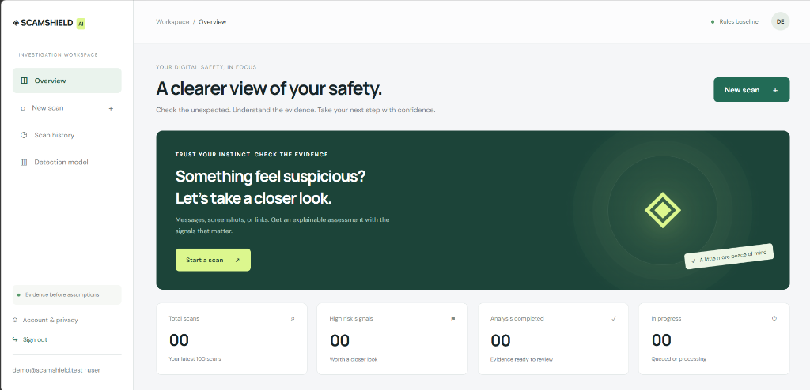
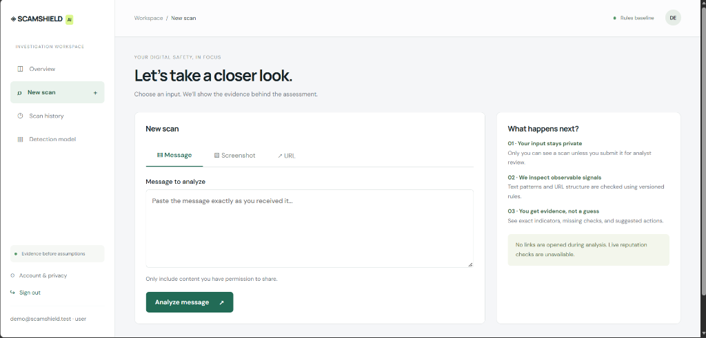
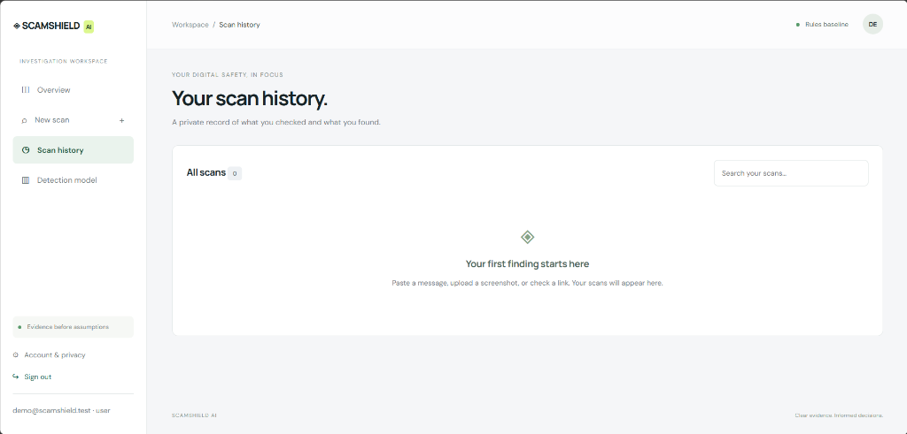
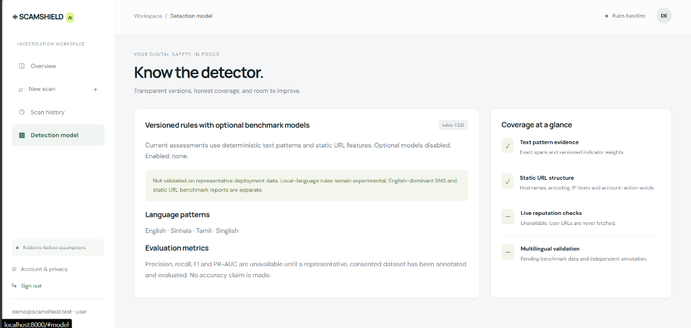
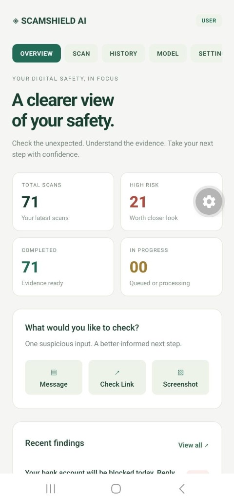

# ScamShield AI

**Explainable Multi-Modal Scam, Phishing URL & Screenshot Detection Platform**

ScamShield AI is a local-first, privacy-preserving cyber defense application for detecting suspicious URLs, multilingual scam messages (English, Sinhala, Singlish, and Tamil), and messaging screenshots. It combines a deterministic, span-level explainable rules engine (`rules-1.2.0`), an offline Public Suffix List (PSL) URL structural analyzer, an SHA256-verified static URL machine learning classifier (`scamshield-url-v1`), a human-confirmed OCR workflow, a responsive web dashboard, and an Expo / React Native Android client.

---

## Key Features

- **Offline Structural URL Inspection & Static ML (`scamshield-url-v1`):** Extracts registrable domain boundaries via the Public Suffix List (PSL), flags brand impersonation (`brand_host`), punycode/IDN homographs, `@` userinfo obfuscation, raw IP literals, non-standard ports, and deep subdomain chains—augmented by a 20-feature static URL classifier without ever fetching or visiting the target URL.
- **Multilingual Scam Text Detection (`rules-1.2.0`):** Detects credential harvesting (OTP/PIN/password requests), urgency pressure, financial/bank suspension traps, fake parcel delivery fees, and lottery lures across **English, Sinhala, Singlish, and Tamil**, while suppressing false positives on legitimate operational warnings (e.g., *"Never share your OTP with anyone"*).
- **Human-in-the-Loop Screenshot OCR:** Validates uploaded images (`PNG`, `JPEG`, `WEBP`), extracts text asynchronously via bundled portable Tesseract 5.5.3 (`eng+sin+tam+osd`), pauses at `awaiting_confirmation` for user review/correction, and runs full scam detection on the confirmed text.
- **Explainable Risk Assessments:** Reports exact character spans, indicator weights, non-clickable URL structural breakdowns, and model provenance (`rules-only` vs. `rules-plus-model`). Scores (`0–100`) are deterministic indicator sums (`0–24` `Inconclusive`, `25–59` `Medium`, `60–100` `High`), never uncalibrated probabilities.
- **Analyst Review Queue & Campaign Clustering:** Users can escalate scans to security analysts, whose verdicts (`Confirmed scam` / `False positive`) propagate directly back into the user's scan history. Staff can inspect clustered scam campaigns grouped by shared domains, phone numbers, and text fingerprints.
- **Role-Based Access Control, TOTP MFA & Audit Logging:** Supports `user`, `analyst`, and `admin` roles. Staff roles require enrolled TOTP multi-factor authentication (with 8 single-use hashed recovery codes), and all privileged actions are recorded in an immutable audit log.

---

## Architecture


---

## Technology Stack

| Layer | Technologies |
|---|---|
| **Backend API & Worker** | Python 3.13, FastAPI, Uvicorn, SQLAlchemy 2.0, Alembic, Pydantic |
| **Database & Queue** | SQLite (WAL mode) by default; PostgreSQL 16 supported; lease-based DB worker queue with heartbeats |
| **AI / ML & Detection** | Deterministic multilingual regex/span rules (`rules-1.2.0`), Public Suffix List (`psl_data.py`), NumPy / scikit-learn static URL logistic classifier (`scamshield-url-v1`), Pillow + Tesseract OCR |
| **Web Dashboard** | Vanilla JavaScript (`ES2022`), semantic HTML5, responsive CSS (`390px`–`1440px`), zero external runtime dependencies |
| **Android Mobile App** | React Native `0.83.6`, Expo SDK `55`, TypeScript `5.9`, `expo-secure-store`, `expo-image-picker` |
| **Testing & Verification** | Pytest (`102` tests), Playwright Headless Chrome E2E (`13` workflow groups), live 10-workflow E2E runner |

---

## AI / ML Detection Architecture & Quality Gates

ScamShield AI enforces a strict **95.0% validation precision gate** (`ml/artifacts/v1-json/manifest.json`) before any machine learning artifact can be enabled in the background worker:

1. **Active Released URL Model (`scamshield-url-v2` — `ml/artifacts/v2-json/url-model.json`):**
   - **Status:** **PROMOTED TO PRODUCTION / ACTIVE** (`validation_eligible: true`, Manifest SHA256 `b9c99c7e5bc4e003357748dd343ca5f9e44fc9c24f03c611f77e4d342ca33606`).
   - **Quality Gate Results:**
     - **Validation Precision:** **97.62%** (Gate $\ge 95.0\%$ — **PASS**)
     - **Validation Recall:** **88.25%** (Gate $\ge 70.0\%$ — **PASS**)
     - **Validation FPR:** **1.68%** (Gate $\le 2.0\%$ — **PASS**)
   - **Path Bias Resolution:** Feature schema upgraded to **`url-static-2`** (28 static features isolating host/subdomain signals from path tokens). Benign deep-path false positives dropped from **80.0% (20/25) down to 12.0% (3/25)** on the 25-case stress benchmark while maintaining **99.94% precision and 91.30% recall** on the untouched 33,660 PhiUSIIL test split.
   - **Integration Policy (`rules-plus-model`):** Negative ML predictions **never** reduce a rule score or remove rule evidence. When a named-domain URL scan scores `Inconclusive` under rules alone and `scamshield-url-v2` predicts `phishing`, the worker elevates the assessment to `Medium` and attaches an explicit indicator note.
2. **Prior Version for Rollback (`scamshield-url-v1` — `ml/artifacts/v1-json/url-model.json`):**
   - **Status:** **VERIFIED ROLLBACK TARGET** (`validation_eligible: true`, Manifest SHA256 `833de7d2d619c033da5fbb71d266793861e498ef5cbcd592a283df843c6ff5a9`).
   - Retained on disk and supported transparently by multi-schema backend loader (`url-static-1`).
3. **Candidate Text Model (`scamshield-text-v1` — `ml/artifacts/v2-json/text-model.json`):**
   - **Status:** **DISABLED** (`validation_eligible: false`).
   - **Reason:** On the cleaned Mendeley SMS dataset (`5,568` messages), the three-class candidate achieved `93.8%` validation smishing precision and `79.10%` test smishing precision—falling short of the `95.0%` precision gate. `backend/app/model_inference.py` automatically rejects ineligible models and relies on `rules-1.2.0`.

---

## Screenshots

### Web Dashboard

| Overview (`Workspace / Overview`) | New Scan (`Workspace / New scan`) |
| :---: | :---: |
|  |  |
| **Scan History (`Workspace / Scan history`)** | **Detection Model (`Workspace / Detection model`)** |
|  |  |

### Android Mobile Application

<p align="center">
  
</p>

---

## Installation

From `D:\ScamShield AI` on Windows PowerShell:

```powershell
python -m venv .venv-release
.\.venv-release\Scripts\python.exe -m pip install -r backend/requirements.txt -r backend/requirements-verification.txt -r ml/requirements.txt
```

For the mobile app (`apps/mobile`):

```powershell
cd "D:\ScamShield AI\apps\mobile"
npm.cmd ci
```

---

## Local Startup

Run the complete local stack using two PowerShell terminals from `D:\ScamShield AI`:

### Terminal 1 — Database Migration, Demo Account & API Server
```powershell
cd "D:\ScamShield AI"
$env:DEV_EMAIL_TOKENS = "1"
$env:SCAMSHIELD_MODEL_DIR = "D:\ScamShield AI\ml\artifacts\v2-json"
$env:SCAMSHIELD_MODEL_MANIFEST_SHA256 = "b9c99c7e5bc4e003357748dd343ca5f9e44fc9c24f03c611f77e4d342ca33606"
.\.venv-release\Scripts\python.exe -m alembic -c backend/alembic.ini upgrade head
.\.venv-release\Scripts\python.exe -m backend.app.demo
.\.venv-release\Scripts\python.exe -m uvicorn backend.app.main:app --host 0.0.0.0 --port 8000 --no-access-log
```

### Terminal 2 — Background Worker (with Active URL ML Model v2)
```powershell
cd "D:\ScamShield AI"
$env:SCAMSHIELD_MODEL_DIR = "D:\ScamShield AI\ml\artifacts\v2-json"
$env:SCAMSHIELD_MODEL_MANIFEST_SHA256 = "b9c99c7e5bc4e003357748dd343ca5f9e44fc9c24f03c611f77e4d342ca33606"
.\.venv-release\Scripts\python.exe -m backend.app.worker
```

- **Web Dashboard:** `http://localhost:8000` (click **Try demo** on localhost to sign in with `demo@scamshield.test` / `ScamShieldDemo123!`)
- **2–3 Minute Portfolio Demo Walkthrough:** See [`docs/PORTFOLIO_DEMO_GUIDE.md`](docs/PORTFOLIO_DEMO_GUIDE.md)

### Optional Staff Administrator Provisioning
```powershell
.\.venv-release\Scripts\python.exe -m backend.app.manage create-admin --email admin@example.com
```

### Optional Mobile App Startup
```powershell
cd "D:\ScamShield AI\apps\mobile"
$env:EXPO_PUBLIC_API_URL = "http://192.168.1.4:8000/api"
npm.cmd start
```

---

## API Documentation

Interactive OpenAPI / Swagger documentation is served automatically at **`http://localhost:8000/docs`**.

| Endpoint | Method | Auth | Description |
|---|---|---|---|
| `/api/health` | `GET` | Public | Verifies database connectivity (`{"status": "ok"}`). |
| `/api/ready` | `GET` | Public | Verifies database connectivity + fresh background worker heartbeat (`<= 30s`). |
| `/api/detection/status` | `GET` | User | Returns active rules version (`rules-1.2.0`), loaded ML models, and provenance metadata. |
| `/api/auth/register` | `POST` | Public | Registers a new account and issues a verification token (`DEV_EMAIL_TOKENS=1` or SMTP). |
| `/api/auth/verify-email` | `POST` | Public | Verifies account email using token. |
| `/api/auth/login` | `POST` | Public | Authenticates user (enforces TOTP/recovery code when MFA is enabled or role is staff). |
| `/api/scans/text` | `POST` | User | Queues a text or URL scan for asynchronous worker analysis (`202 Accepted`). |
| `/api/scans/screenshot` | `POST` | User | Validates and uploads a screenshot (`PNG`/`JPEG`/`WEBP`) for OCR extraction. |
| `/api/scans/{id}/confirm-text` | `POST` | User | Submits user-reviewed OCR text for final scam detection. |
| `/api/scans/{id}/report` | `POST` | User | Escalates a scan to the analyst review queue. |
| `/api/analyst/reports` | `GET` | Analyst/Admin | Lists escalated user reports for analyst triage. |
| `/api/analyst/campaigns` | `GET` | Analyst/Admin | Lists clustered scam campaigns by shared domain, phone, or text hash. |
| `/api/admin/users` | `GET` | Admin | Lists users and manages role assignments (requires MFA for staff promotion). |
| `/api/admin/audit-logs` | `GET` | Admin | Lists immutable security and role-change audit records. |

---

## Testing

Run the full verification suite from `D:\ScamShield AI`:

```powershell
# 1. Backend pytest suite (102 passed, 1 skipped)
.\.venv-release\Scripts\python.exe -m pytest backend/tests -q

# 2. Live 10-workflow End-to-End verification (API + Worker + SQLite + URL ML)
.\.venv-release\Scripts\python.exe scripts/verify_final_e2e.py

# 3. ML artifact SHA256 & 33,660-URL frozen test split verification
.\.venv-release\Scripts\python.exe scripts/verify_model_artifacts.py

# 4. Automated Chrome Playwright browser verification (13 workflow groups across 3 viewports)
.\.venv-release\Scripts\python.exe scripts/verify_browser.py

# 5. Alembic migration, Git exclusion & SQLite concurrency benchmark checks
.\.venv-release\Scripts\python.exe scripts/verify_migrations.py
.\.venv-release\Scripts\python.exe scripts/verify_exclusions.py
.\.venv-release\Scripts\python.exe -m backend.tests.benchmark

# 6. Web JS syntax & Mobile TypeScript / Android bundle checks
node --check apps/dashboard/app.js
node --check apps/dashboard/results.js
cd apps/mobile
npm.cmd run typecheck
```

See [`docs/SCAMSHIELD_FINAL_TEST_RESULTS.md`](docs/SCAMSHIELD_FINAL_TEST_RESULTS.md) and [`docs/SCAMSHIELD_FINAL_PROJECT_COMPLETION_REPORT.md`](docs/SCAMSHIELD_FINAL_PROJECT_COMPLETION_REPORT.md) for complete test records.

---

## Evaluation Results

| Evaluation Benchmark | Mode | Sample Size | Precision | Recall | F1 Score | False Positive Rate |
|---|---|---:|---:|---:|---:|---:|
| **PhiUSIIL Held-Out URL Test Split** | `rules-only` (`rules-1.2.0`) | 33,660 | 100.00% | 4.60% | 8.79% | 0.00% |
| **PhiUSIIL Held-Out URL Test Split** | `scamshield-url-v1` (ML) | 33,660 | **99.93%** | **99.21%** | **99.57%** | **0.05%** |
| **Synthetic URL Evaluation Set** | `rules-only` (`rules-1.2.0`) | 215 | 100.00% | 61.74% | 76.34% | 0.00% |
| **Synthetic Suspicious URLs** | `rules-plus-model` | 115 | — | **100.00%** | — | — |
| **Synthetic Multilingual Text Set** (EN/SI/Singlish) | `rules-only` (`rules-1.2.0`) | 200 | **100.00%** | **95.00%** | **97.44%** | **0.00%** |
| **Synthetic Screenshot OCR Pipeline** | OCR + Confirmation + Rules | 30 | **100.00%** | **100.00%** | **100.00%** | **0.00%** |

---

## Security Considerations

- **No Active URL Probing:** Submitted URLs are parsed strictly offline; ScamShield AI never connects to, resolves, or renders untrusted URLs.
- **Credential & Session Hardening:** Passwords use `PBKDF2-HMAC-SHA256` (`390,000` iterations); session tokens and MFA recovery codes are stored exclusively as SHA256 hashes.
- **Privileged MFA Enforcement:** Analyst and Admin accounts cannot authenticate or be promoted without active TOTP MFA enrollment.
- **Strict Tenant Isolation:** All user scan queries and mutations filter by `Scan.user_id`, returning `HTTP 404` on cross-tenant access attempts.
- **Safe Upload Storage:** Uploaded screenshots are validated via magic bytes and Pillow `Image.verify()`, renamed to random UUIDs, stored outside the static web root, and purged upon scan or account deletion.

---

## Limitations

1. **URL ML Source-Dataset Domain Shift:** In the PhiUSIIL benchmark, legitimate URLs are predominantly bare root domains (`https://www.domain.com` with `path_length == 0`) and `100%` HTTPS. Consequently, `scamshield-url-v1` can over-flag benign URLs that contain deep file paths (`path_length > 0`, `slashes >= 3`) as `Medium`.
2. **Text ML Candidate Disabled:** The Mendeley SMS candidate classifier (`scamshield-text-v1`) did not meet the `95.0%` smishing precision gate (`79.10%` test precision) and remains disabled in favor of deterministic multilingual rules (`rules-1.2.0`).
3. **Uncalibrated Risk Scores:** Rule scores (`0–100`) are linear indicator weight sums and ML outputs are uncalibrated logistic scores from historical datasets—neither represents a real-world probability of fraud.
4. **Local Native Dependencies:** Screenshot OCR is bundled with standalone Tesseract 5.5.3 in `tools/tesseract` and auto-detected by the background worker. If run in an environment without Tesseract, scans pause cleanly at `partially_completed` for manual text entry. Physical Android device testing requires a connected USB/ADB device or same-LAN Expo client.

---

## Future Improvements

- Train a path-diverse URL classifier incorporating benign deep-path URLs (documentation pages, e-commerce product paths, and localized Sri Lankan `.lk` domains) to eliminate path-length domain shift.
- Expand native Sinhala and Tamil SMS corpus collection to train a calibrated, precision-gated multilingual text classifier.
- Add optional offline SQLite scan caching in `apps/mobile` and automated EAS Android APK preview builds.
- Add optional Celery/Redis worker orchestration and S3-compatible object storage for cloud deployment.
