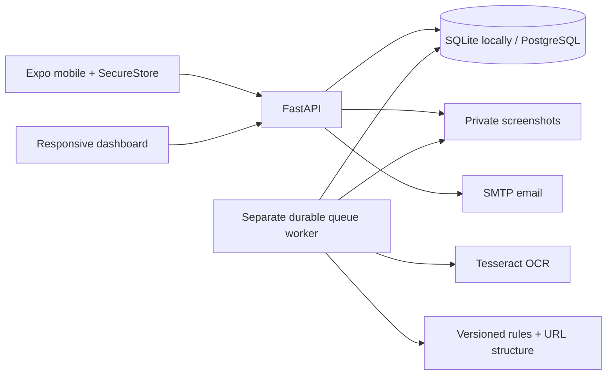
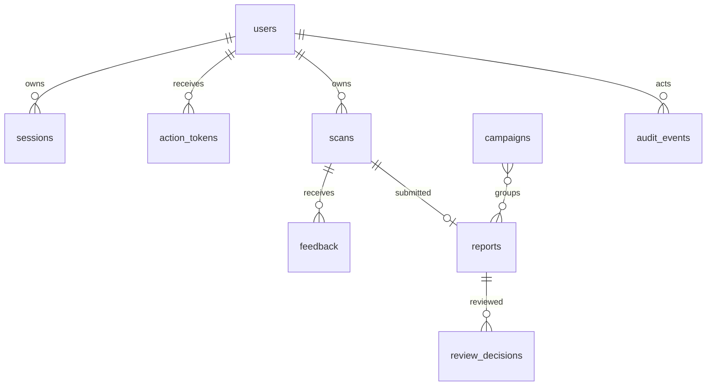

# Architecture and permissions

Campaign membership is a validated JSON list in this baseline. Evidence, extracted entities, version and coverage are persisted in scan result JSON; protected original and normalized text are separate scan columns. Screenshot filenames are random and never publicly served. This is a simplified schema compared with the proposed fully normalized production schema.

| Capability | User | Analyst | Admin |
|---|---|---|---|
| Create/read/delete own scans | Yes | Yes | Yes |
| Read another user's unreported scan | No | No | No |
| Submit own scan report/feedback | Yes | Yes | Yes |
| View submitted reports and record decisions | No | Yes | Yes |
| Review campaign relationships/group/dissolve | No | Yes | Yes |
| Manage roles and view audit | No | No | Yes |

Tokens are random opaque credentials hashed in the database; passwords use salted scrypt. Sessions expire after 24 hours. Logout, password reset, account deletion and role updates revoke relevant sessions. MFA enrollment requires a confirmed TOTP code. Staff recovery uses password plus a single-use hashed recovery code; regeneration requires reauthentication, revokes all sessions and writes an audit event.

## Scan state machine

`queued → processing → completed` for text/URL. Screenshots move through `awaiting_confirmation → queued → processing → completed`. OCR failures return `partially_completed` and permit manual text entry. Unexpected processing exceptions retry at most three times, then return `failed` with Inconclusive. A stale processing lease (180 seconds) can be reclaimed after a worker crash. OCR has a 45-second timeout. Requests accept a per-user Idempotency-Key for text/URL creation.

Only reported scans become visible to staff. Analyst outcomes are append-only review rows; predictions are preserved separately. Reports and feedback never become training labels automatically. Candidate graph edges list shared domain/phone evidence, and reviewed campaigns require analyst reasons.

Rate limits use atomic SQLite/PostgreSQL upserts into persisted buckets. Concurrent SQLite checks pass; PostgreSQL verification remains blocked. Upload requests read at most 5 MB plus one byte, validate suffix, MIME, decoded format and dimensions, correct EXIF orientation and re-encode without original metadata. Private directories/files request modes 0700/0600; Unix enforcement remains container-unverified.

Migration 0002 adds hashed recovery codes, worker leases, heartbeats and operational counters. Enrolled users, including staff, supply an authenticator or one-time recovery code at login. Recovery login and code regeneration revoke prior sessions; regeneration requires password reauthentication. Queue claims renew leases and only the current lease owner can persist results. Repeated stale claims exhaust after three attempts instead of recovering indefinitely.
